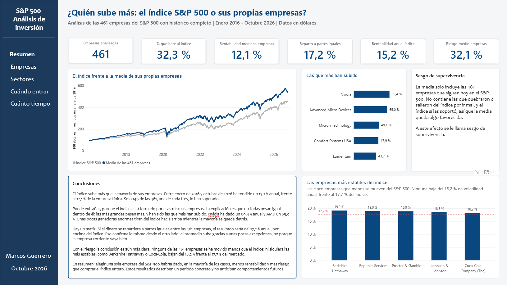
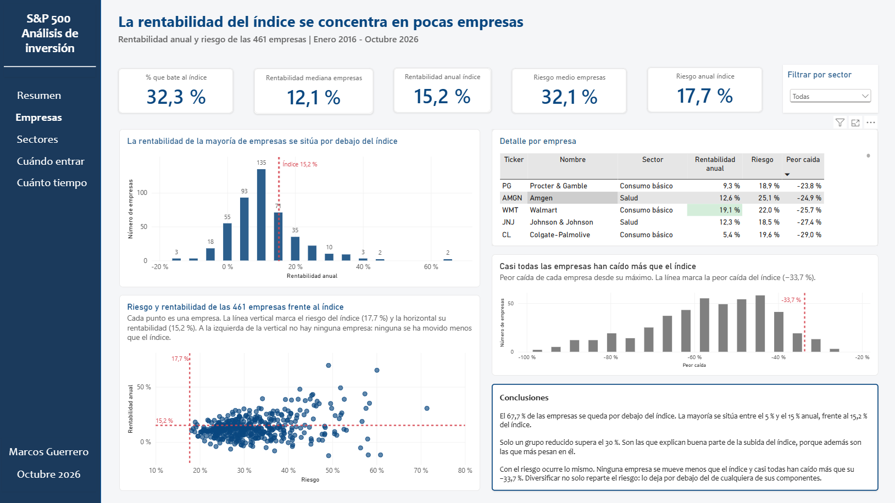
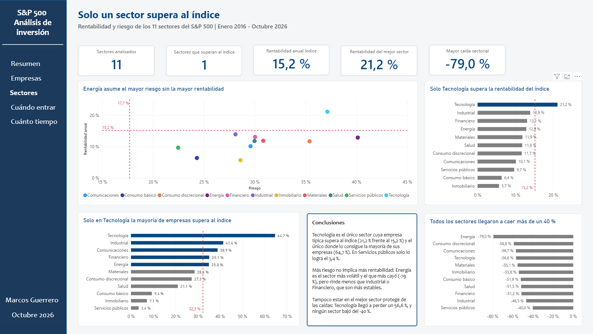
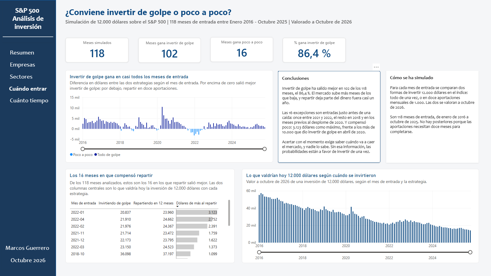
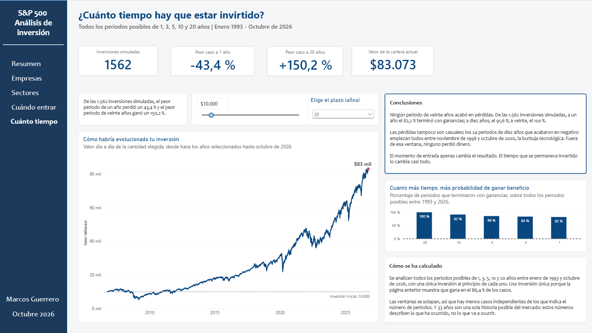
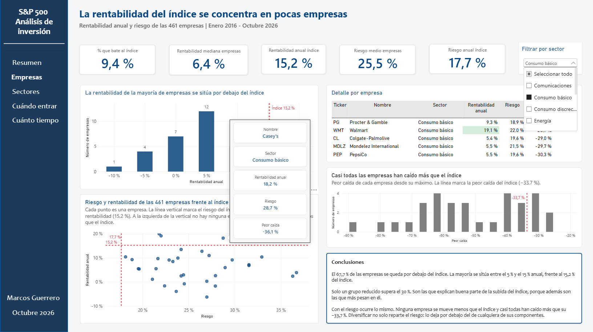

# ¿Merece la pena elegir acciones del S&P 500?

**Solo 149 de las 461 empresas del S&P 500 han superado al índice en los últimos diez años. Y ninguna de las 461 ha tenido menos riesgo que él.**

Análisis completo del S&P 500 con Python, SQL y Power BI: descarga de datos, limpieza, cálculo de métricas y un informe de cinco páginas que responde a tres preguntas sobre invertir en bolsa.



---

## Las preguntas que responde

| Pregunta | Respuesta |
|---|---|
| **¿Qué comprar?** ¿Empresas sueltas o el índice entero? | El índice. Solo el 32,3 % de las empresas lo supera, y ninguna se mueve menos que él |
| **¿Cuándo entrar?** ¿De golpe o poco a poco? | Casi da igual: invertir de una vez gana en el 86,4 % de los meses analizados |
| **¿Cuánto tiempo quedarse?** | Lo cambia todo: del 82,2 % de periodos ganadores a un año al 100 % a veinte |

La conclusión del informe: **dos de las tres decisiones importan mucho, y la del medio casi nada.**

---

## Hallazgos principales

- El índice ha rendido un **15,2 % anual** entre enero de 2016 y octubre de 2026. La empresa típica, un **12,1 %**.
- **Ninguna de las 461 empresas** tiene menos volatilidad que el índice. Ni siquiera las más estables: Berkshire Hathaway se mueve un 19,2 % anual y Coca-Cola un 18,2 %, frente al 17,7 % del índice.
- La peor caída del índice fue del **−33,7 %**. La mayoría de los sectores llegaron a caer más del 50 %.
- De los once sectores, **solo Tecnología** supera la rentabilidad del índice.
- Repartir una inversión en doce aportaciones solo compensó en **16 de 118 meses**, y todos ellos justo antes de una caída del mercado.
- Sobre 33 años de histórico (1993-2026) y **1.562 periodos simulados**: a un año se ganó en el 82,2 % de los casos; a diez, en el 91,6 %; a veinte, en el **100 %**. El peor periodo de veinte años acabó con un **+150,2 %**.

---

## El dashboard

Cinco páginas, cada una con una pregunta y su respuesta.

| | |
|---|---|
| **Resumen** — el índice frente a sus empresas |  |
| **Empresas** — distribución de rentabilidad y riesgo |  |
| **Sectores** — qué sectores baten al índice |  |
| **Cuándo entrar** — de golpe o poco a poco |  |
| **Cuánto tiempo** — simulador por plazo |  |

Con tooltips personalizados que muestran el detalle de cada empresa, sector o plazo al pasar el ratón:



---

## Cómo está hecho

**Python** — descarga y análisis
`pandas`, `yfinance`, `requests`, `matplotlib`

**MySQL** — consultas sobre los datos procesados
Agregaciones, funciones de ventana, CTEs y joins

**Power BI** — informe de cinco páginas
Modelo de datos, medidas DAX, parámetros what-if y tooltips personalizados

---

## Estructura

```
.
├── notebooks/
│   ├── 00_descarga_datos.ipynb      Lista del S&P 500 y precios diarios
│   ├── 01_exploracion.ipynb         Nulos, duplicados y precios sospechosos
│   ├── 02_limpieza.ipynb            Filtros automáticos y traducción de sectores
│   ├── 03_metricas.ipynb            Rentabilidad, riesgo y peor caída
│   ├── 04_momento_entrada.ipynb     Simulación de golpe frente a poco a poco
│   └── 05_probabilidad_plazo.ipynb  Ventanas de 1, 3, 5, 10 y 20 años
├── sql/
│   ├── 01_crear_y_cargar.sql
│   └── 02_consultas.sql
├── powerBI/
│   └── dashboard_sp500.pbix        Informe de cinco páginas
├── images/
└── requirements.txt
```

Las carpetas de datos no están en el repositorio: los CSV los generan los propios notebooks al ejecutarse.

---

## Cómo ejecutarlo

```bash
git clone https://github.com/Marcosguerrero19/Analisis-SP500.git
cd Analisis-SP500
pip install -r requirements.txt
```

Y ejecuta los notebooks en orden, del `00` al `05`.

**No hace falta cambiar ninguna ruta.** Cada notebook detecta si se está ejecutando en Google Colab o en local y ajusta las carpetas solo.

Los datos se descargan en el momento, así que **los resultados se recalculan con las cotizaciones del día**. Las cifras de este README corresponden a la ejecución de octubre de 2026 y pueden variar ligeramente.

El informe de Power BI está en `powerBI/dashboard_sp500.pbix`. Se abre y se navega sin configurar nada. Para actualizarlo con datos nuevos hay que ejecutar antes los notebooks y reapuntar el origen de datos a tu carpeta `Data/Processed/`, porque el archivo guarda rutas absolutas.

---

## Limitaciones

Están documentadas también dentro del propio informe.

**Sesgo de supervivencia.** El análisis incluye las 461 empresas que siguen hoy en el índice, no las que quebraron o salieron de él. Eso hace que los resultados de las empresas salgan algo mejores de lo que fueron en realidad. Corregirlo exigiría reconstruir la composición histórica del índice.

**Ventanas solapadas.** En el análisis por plazos, el periodo que empieza en enero y el que empieza en febrero comparten casi todos sus meses. Hay menos casos independientes de los que indica el número de periodos.

**Una sola historia.** Treinta y tres años de mercado estadounidense son una única trayectoria posible. Los números describen lo que ocurrió, no lo que ocurrirá.

**Fuente no oficial.** Los precios vienen de `yfinance`, una librería de la comunidad que accede a Yahoo Finance. No es una API oficial y puede dejar de funcionar.

---

## Autor

**Marcos Guerrero Sánchez** — Valencia, España

Técnico de ensayo eléctrico orientándome al análisis de datos. Máster en Data Analytics.

[LinkedIn](https://www.linkedin.com/in/) · [GitHub](https://github.com/Marcosguerrero19)
